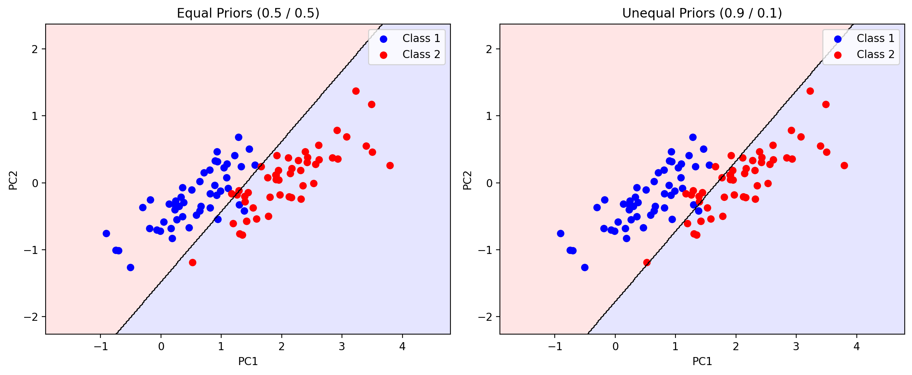
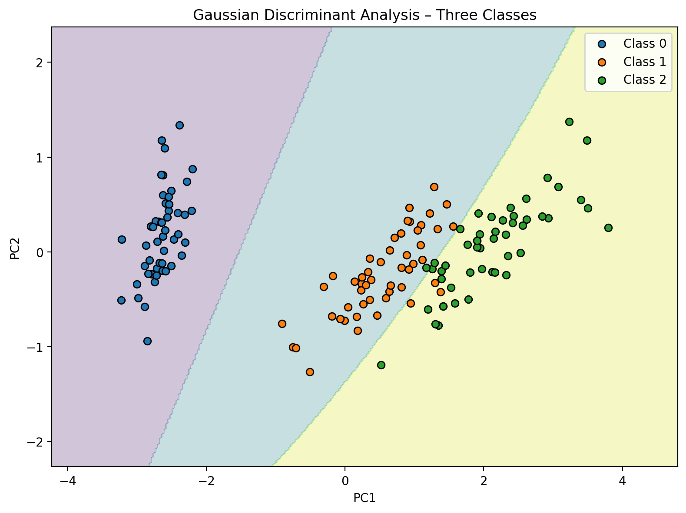
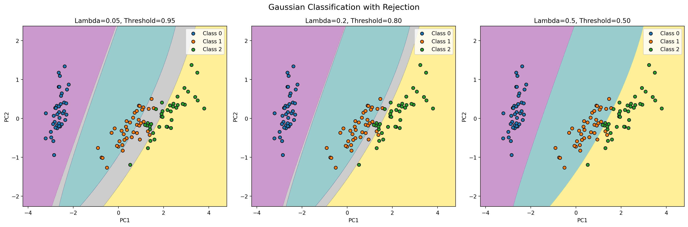
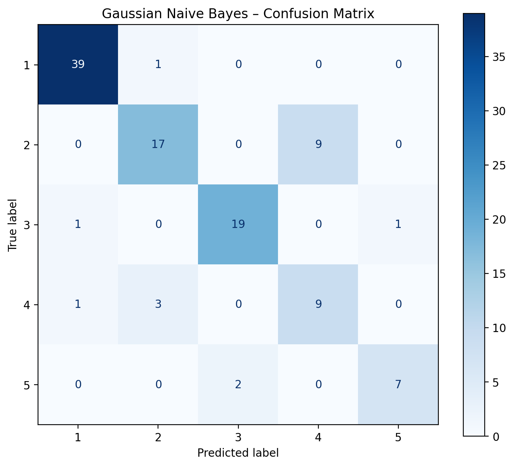
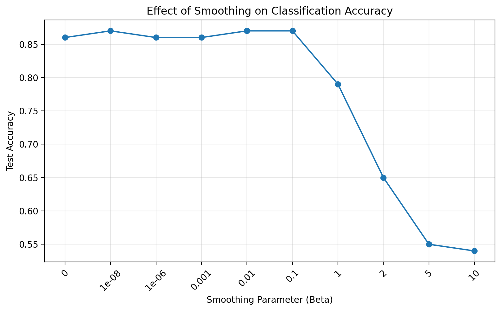
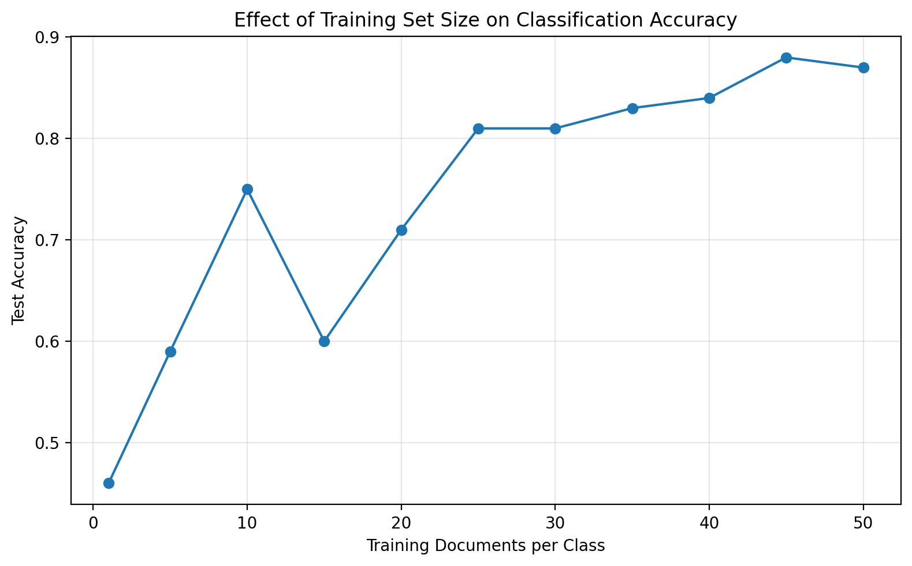

# Machine Learning – Assignment 1

This assignment implements and evaluates probabilistic classification methods using Python.

## Assignment Overview

The assignment covers three classification problems:

- **Question 6:** Gaussian Discriminant Analysis (GDA)
- **Question 7:** Gaussian Naive Bayes
- **Question 8:** Bag of Words Naive Bayes

## Requirements

The project uses Python and the following libraries:

- NumPy
- Pandas
- Matplotlib
- Scikit-learn
- SciPy

Install the dependencies:

```bash
pip install numpy pandas matplotlib scikit-learn scipy
```

## Question 6 – Gaussian Discriminant Analysis

The Iris dataset is used, with PCA reducing its four features to two dimensions.

The experiments include:

- Gaussian parameter estimation with shared and class-specific covariance matrices.
- Decision boundaries and the effect of class priors.
- Three-class classification.
- Training with 80% of the dataset.
- Classification with a rejection option.

### Method

Each class is modeled using a multivariate Gaussian distribution:

$$
p(x\mid y=k)=
\frac{1}{(2\pi)^{d/2}|\Sigma_k|^{1/2}}
\exp\left(
-\frac{1}{2}(x-\mu_k)^T
\Sigma_k^{-1}(x-\mu_k)
\right)
$$

where $\mu_k$ and $\Sigma_k$ are the mean vector and covariance matrix of class $k$.

For two-class classification with a shared covariance matrix, the discriminant function is:

$$
g_k(x)=x^T\Sigma^{-1}\mu_k
-\frac{1}{2}\mu_k^T\Sigma^{-1}\mu_k
+\log P(y=k)
$$

The decision boundary is obtained by setting the two discriminant functions equal:

$$
g_1(x)-g_2(x)=0
$$

This produces a linear decision boundary.

For three-class classification with class-specific covariance matrices, the discriminant function becomes:

$$
g_k(x)=
-\frac{1}{2}(x-\mu_k)^T\Sigma_k^{-1}(x-\mu_k)
-\frac{1}{2}\log|\Sigma_k|
+\log P(y=k)
$$

For classification with rejection, the implementation rejects a prediction when the maximum posterior probability is below the threshold:

$$
\max_k P(y=k\mid x)<1-\lambda
$$

where $\lambda$ is the rejection cost and the misclassification cost is 1.

### Results

**Decision boundaries with different class priors:**



**Three-class classification regions:**



**Classification with rejection for different rejection costs:**



## Question 7 – Gaussian Naive Bayes

A Gaussian Naive Bayes classifier is implemented from scratch using the provided dataset.

The implementation includes:

- Class prior estimation.
- Gaussian likelihood estimation.
- Classification using log-probabilities.
- Evaluation using accuracy, precision, and recall.

### Method

The Naive Bayes classifier assumes conditional independence between features given the class:

$$
P(c\mid x)\propto P(c)\prod_{j=1}^{d}P(x_j\mid c)
$$

Each feature is modeled using a one-dimensional Gaussian distribution:

$$
P(x_j\mid c)=
\frac{1}{\sqrt{2\pi\sigma_{j,c}^{2}}}
\exp\left(
-\frac{(x_j-\mu_{j,c})^2}{2\sigma_{j,c}^{2}}
\right)
$$

The predicted class is selected by maximizing the log-posterior:

$$
\hat{c}=
\arg\max_c
\left[
\log P(c)+
\sum_{j=1}^{d}\log P(x_j\mid c)
\right]
$$

**Test accuracy: 83.5%**

**Confusion matrix:**



## Question 8 – Bag of Words Naive Bayes

A binary text classifier is developed to distinguish between Baseball and Hockey documents using Bag of Words representations.

The experiments compare:

- Maximum Likelihood Estimation (MLE).
- Maximum A Posteriori (MAP) with a symmetric Dirichlet prior.
- Different smoothing parameters ($\beta$).
- Different training set sizes.

### Method

Each document is represented as a vector of word counts.

For MLE, the probability of word $w$ given class $c$ is estimated as:

$$
\hat{P}(w\mid c)=
\frac{\text{count}(w,c)}
{\sum_{w'}\text{count}(w',c)}
$$

For MAP estimation with Dirichlet smoothing:

$$
\hat{P}(w\mid c)=
\frac{\text{count}(w,c)+\beta}
{\sum_{w'}\text{count}(w',c)+\beta V}
$$

where $\beta$ is the smoothing parameter and $V$ is the vocabulary size.

Classification is performed using log-probabilities:

$$
\log P(x\mid c)=
\sum_w x_w\log\hat{P}(w\mid c)
$$

The predicted class is the one with the highest log-probability, assuming equal class priors.

### Experimental Results

| Method | Accuracy |
|---|---:|
| MLE | 50% |
| Best MAP | 87% |
| Best training-size experiment | 88% |

**Effect of smoothing parameter:**



**Effect of training set size:**



## Repository Structure

```text
Assignment1/
├── README.md
├── Assignment1.ipynb
├── figs/
│   ├── gda_decision_boundaries.png
│   ├── gda_three_classes.png
│   ├── gda_rejection_regions.png
│   ├── gaussian_nb_confusion_matrix.png
│   ├── naive_bayes_beta.png
│   └── naive_bayes_training_size.png
└── data/
    ├── guassianBayes.mat
    ├── baseball_train_set.csv
    ├── baseball_test_set.csv
    ├── hockey_train_set.csv
    ├── hockey_test_set.csv
    └── vocabulary.txt
```

## How to Run

1. Clone or download the repository.
2. Install the required dependencies.
3. Place all datasets inside the `data/` directory.
4. Open `Assignment1.ipynb` using Jupyter Notebook or JupyterLab.
5. Run all cells sequentially to reproduce the experiments and generate the figures.

```bash
pip install numpy pandas matplotlib scikit-learn scipy
jupyter notebook Assignment1.ipynb
```

## Conclusion

This assignment explores Gaussian Discriminant Analysis, Gaussian Naive Bayes, and Bag of Words classification. The experiments demonstrate the effects of class priors, covariance assumptions, rejection costs, probability smoothing, and training set size on classification performance.