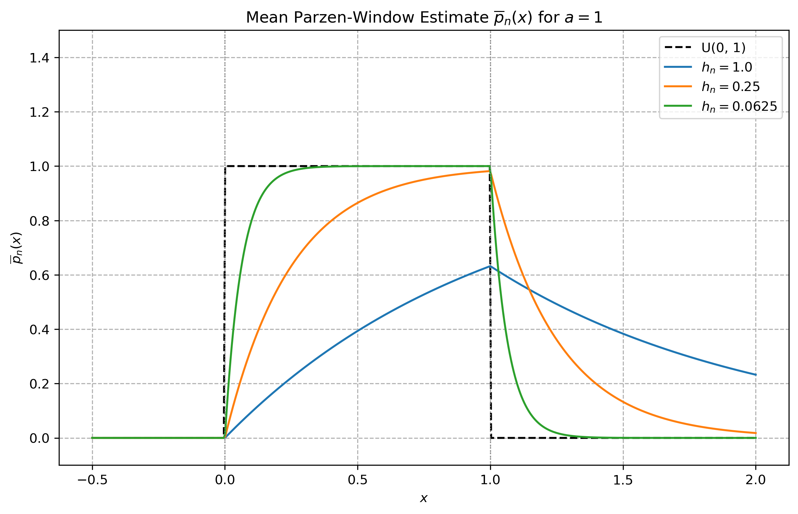
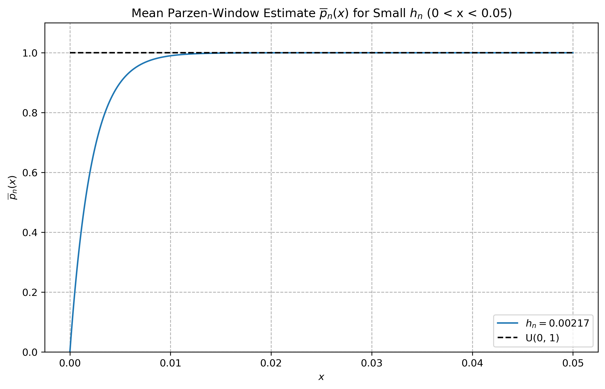
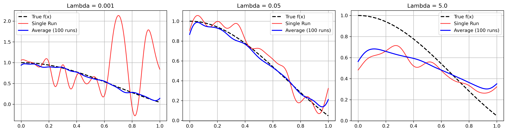
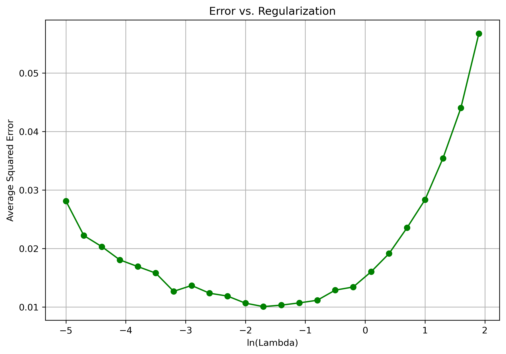

# Machine Learning – Assignment 2

This assignment explores statistical learning methods, including Parzen-window density estimation, non-parametric classification, maximum likelihood estimation, hypothesis testing, and nonlinear regression using Gaussian basis functions.

## Assignment Overview

The notebook covers four questions:

- **Question 1:** Parzen Window Density Estimation
- **Question 10:** Parzen Window Classification with a Gaussian Kernel
- **Question 11:** Maximum Likelihood Estimation
- **Question 12:** Non-Linear Regression Using Basis Functions

## Requirements

The project uses Python and the following libraries:

- NumPy
- Matplotlib
- SciPy

Install the dependencies with:

```bash
pip install numpy matplotlib scipy
```

## Question 1: Parzen Window Density Estimation

This question investigates the expected Parzen-window estimate for a uniform distribution \(U(0,a)\), using the exponential window function.

The mean estimate is implemented and plotted for \(a=1\) and three different window widths:

\[
h_n \in \{1,\ 0.25,\ 0.0625\}
\]

The plots demonstrate how the bandwidth affects the estimated density and its boundary bias.



The bandwidth required to achieve less than 1% relative bias over 99% of the interval is calculated using:

\[
h_n \leq \frac{0.01}{-\ln(0.01)}
\]

For \(a=1\), this gives:

\[
h_n \approx 0.00217
\]

The resulting estimate is plotted over the interval \(0 \leq x \leq 0.05\).



## Question 10: Parzen Window Classification

A non-parametric Parzen-window classifier is implemented using a spherical Gaussian kernel.

The training dataset contains three categories, each represented by ten three-dimensional samples.

The classifier evaluates three test points:

\[
(0.50,1.0,0.0)^T
\]

\[
(0.31,1.51,-0.50)^T
\]

\[
(-0.3,0.44,-0.1)^T
\]

Classification is performed using two bandwidth values:

- \(h=1.0\)
- \(h=0.1\)

For each test point, the Gaussian kernel contributions from the training samples are summed separately for each class. The predicted category is the one with the highest estimated density.

This experiment demonstrates how the bandwidth controls the influence of nearby training samples and affects the classification process.

## Question 11: Maximum Likelihood Estimation

This question uses the data in `normal.data.txt`, which is assumed to be a random sample from a normal distribution.

The following statistical methods are implemented:

**Parameter estimation**
- Numerical maximum likelihood estimation of the mean and variance.
- Closed-form maximum likelihood estimates.
- Comparison of numerical and analytical solutions.
- Verification that the negative log-likelihood is minimized at the estimated parameters.

**Asymptotic covariance and confidence intervals**
- Estimation of the asymptotic covariance matrix.
- Calculation of an improved covariance estimate using the closed-form solution.
- A large-sample 95% confidence interval for the variance.

**Hypothesis testing**

The null hypothesis

\[
H_0:\mu=103
\]

is tested using three methods:

1. Z-test
2. Likelihood ratio test
3. Wald test

The test statistics and p-values are calculated and compared.

**Coefficient of variation**

Finally, the coefficient of variation is estimated:

\[
CV=\frac{\sigma}{\mu}
\]

Its invariance under multiplication by a positive constant is considered, and a 95% confidence interval is calculated using the delta method.

## Question 12: Non-Linear Regression Using Basis Functions

This question investigates nonlinear regression using Gaussian basis functions and ridge regression.

The objective is to approximate the sinc function:

\[
f(x)=\frac{\sin(3x)}{3x}
\]

with the value at \(x=0\) defined by continuity as \(f(0)=1\).

The training data consists of 25 uniformly sampled input points with additive zero-mean Gaussian noise:

\[
y=f(x)+\epsilon,\qquad \epsilon\sim N(0,0.01)
\]

**Gaussian basis functions**

The regression model uses 21 Gaussian basis functions:

\[
h_j(x)=
\exp\left(-\frac{(x-\mu_j)^2}{2\sigma^2}\right)
\]

The basis function means are equally spaced over \([0,1]\), with:

\[
\sigma=0.04
\]

A bias term is also included, giving 22 coefficients in total.

**Ridge regression**

The regression coefficients are estimated using:

\[
\hat{\beta}=
(H^TH+\lambda I)^{-1}H^Ty
\]

Three regularization parameters are investigated:

\[
\lambda\in\{0.001,\ 0.05,\ 5\}
\]

For each value of \(\lambda\), the estimated function from a single experiment is compared with the average estimate obtained from 100 independent experiments.



**Error versus regularization**

The average squared estimation error is also calculated over 100 experiments for a range of regularization values.

The error is evaluated on 100 equally spaced test points:

\[
err=\frac{1}{m}\sum_{i=1}^{m}
\left(f(z_i)-\hat f(z_i)\right)^2
\]

The resulting plot illustrates the effect of regularization on model performance.



The experiment demonstrates the bias-variance trade-off:

- **Small \(\lambda\):** Weak regularization can cause overfitting and high variance.
- **Moderate \(\lambda\):** A suitable balance between bias and variance can improve estimation accuracy.
- **Large \(\lambda\):** Strong regularization can cause underfitting and high bias.

## Repository Structure

```text
Assignment2/
│
├── README.md
├── Assignment2.ipynb
├── normal.data.txt
│
└── figs/
    ├── parzen_window_estimates.png
    ├── parzen_small_bandwidth.png
    ├── regression_lambda_comparison.png
    └── regression_error_vs_lambda.png
```

## How to Run

1. Clone or download the repository.
2. Install the required Python libraries.
3. Make sure `normal.data.txt` is located in the same directory as the notebook.
4. Open and run the notebook:

```bash
jupyter notebook Assignment2.ipynb
```

The notebook generates and saves the figures automatically in the `figs/` directory.

## Conclusion

This assignment demonstrates several important statistical learning techniques, from non-parametric density estimation and classification to maximum likelihood inference and regularized nonlinear regression.

The experiments illustrate the influence of bandwidth selection, the relationship between estimation and hypothesis testing, and the bias-variance trade-off in regression models.