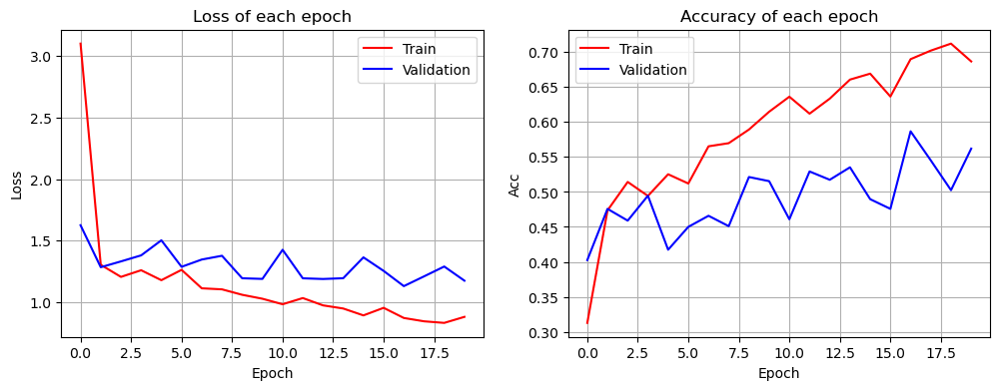
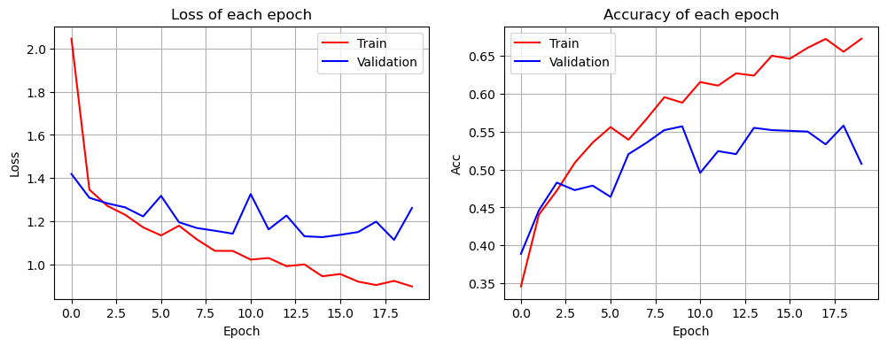
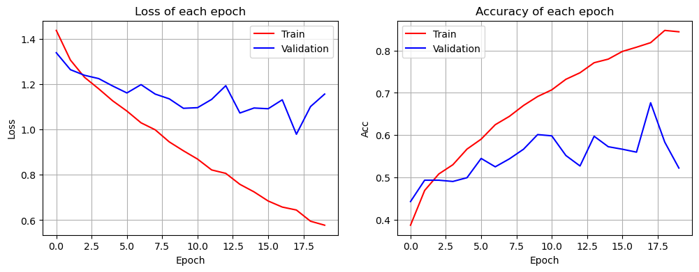
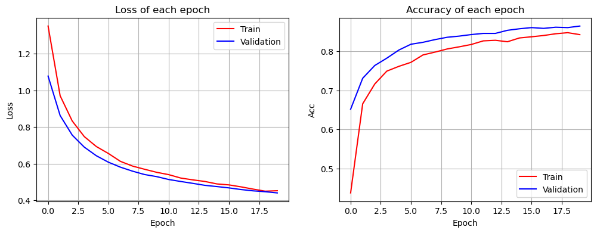
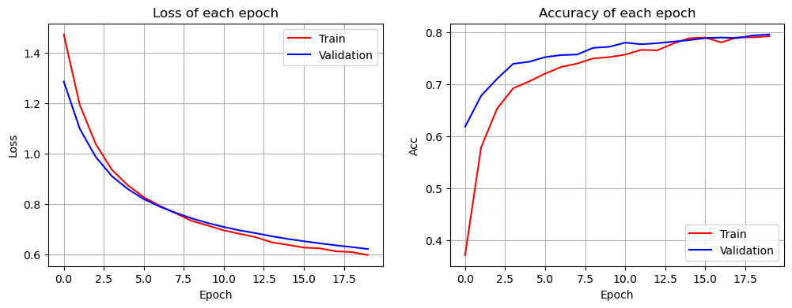

# Machine Learning – Assignment 3

This assignment explores feature selection techniques and neural network models for image classification using Python.

## Assignment Overview

The assignment covers two computational exercises:

- **Question 7:** Feature Selection with Gaussian Naive Bayes
- **Question 8:** Flower Image Classification using Neural Networks and Transfer Learning

## Requirements

The project uses Python and the following libraries:

- NumPy
- Pandas
- Matplotlib
- Scikit-learn
- PyTorch
- Torchvision
- TorchMetrics
- TorchSummary
- Pillow
- tqdm

Install the dependencies:

```bash
pip install numpy pandas matplotlib scikit-learn torch torchvision torchmetrics torchsummary pillow tqdm
```

## Question 7 – Feature Selection with Naive Bayes

The TinyMNIST dataset is used to perform feature selection for a Gaussian Naive Bayes classifier.

The experiments compare two feature selection methods:

- Forward Selection.
- Backward Elimination.

### Preprocessing

The original dataset contains 784 features corresponding to the pixels of 28 × 28 images.

A `VarianceThreshold` selector is applied to remove features with variance below 0.09:

$$
\text{threshold}=0.90(1-0.90)=0.09
$$

After preprocessing, the feature set is reduced from 784 to 62 features.

The dataset contains 5,000 training samples and 2,500 test samples.

### Method

The Gaussian Naive Bayes classifier is evaluated using the Correct Classification Rate (CCR):

$$
CCR=
\frac{\text{Number of Correct Predictions}}
{\text{Total Number of Samples}}
\times 100
$$

**Forward Selection**

Forward Selection starts with an empty feature subset. At each iteration, every remaining feature is evaluated, and the feature that produces the highest CCR is added to the selected subset.

The process stops when adding another feature does not improve the best CCR.

**Backward Elimination**

Backward Elimination starts with the complete feature set. At each iteration, each feature is temporarily removed and the resulting subset is evaluated.

The feature whose removal produces the highest CCR is permanently removed, provided that the CCR does not decrease.

### Results

| Method | Number of Selected Features | Best CCR |
|---|---:|---:|
| Full feature set | 62 | 76.48% |
| Forward Selection | 28 | 79.04% |
| Backward Elimination | 52 | **79.52%** |

Backward Elimination achieves the highest CCR of 79.52%, while Forward Selection produces a smaller feature subset with comparable performance.

Forward Selection is more efficient in terms of the number of retained features, whereas Backward Elimination provides slightly better classification accuracy.

## Question 8 – Flower Image Classification

The flower dataset is used to classify images into five classes using neural networks and transfer learning.

The experiments compare five architectures:

1. Linear Neural Network.
2. Neural Network with One ReLU Hidden Layer.
3. Improved Neural Network with Regularization.
4. AlexNet with a Frozen Backbone.
5. VGG16 with a Frozen Backbone.

### Dataset and Preprocessing

The dataset is organized into training and validation directories, each containing five class-specific subdirectories.

Images are loaded using PyTorch's `ImageFolder`.

The preprocessing pipeline includes:

- Resizing images to 224 × 224 pixels.
- Converting images to tensors.
- Converting pixel values to floating-point values in the range [0, 1].

### Training Configuration

| Parameter | Value |
|---|---|
| Number of classes | 5 |
| Image size | 224 × 224 |
| Batch size | 128 |
| Optimizer | Adam |
| Loss function | Cross-Entropy Loss |
| Learning rate | 0.0001 |
| Random seed | 0 |
| Device | CUDA if available, otherwise CPU |

Training and validation are implemented using manual loops without high-level training APIs such as `model.fit()`.

The training and validation loss and accuracy are recorded at each epoch.

### Part I – Training from Scratch

#### 1. Linear Neural Network

A fully linear neural network is implemented without intermediate activation functions.

The input image is flattened and passed directly to a linear layer with five output neurons.

```text
Input Image
    |
  Flatten
    |
Linear Layer
    |
5 Output Scores
```

**Training configuration:**

- Optimizer: Adam
- Learning rate: 0.0001
- Epochs: 20

**Best validation accuracy: 58.65%**

**Training and validation curves:**

<p align="center">
  
</p>

#### 2. Neural Network with One ReLU Hidden Layer

A neural network with one hidden layer containing 128 neurons is implemented using ReLU activation.

```text
Input Image
    |
  Flatten
    |
Linear (128 neurons)
    |
   ReLU
    |
Linear (5 outputs)
```

**Training configuration:**

- Optimizer: Adam
- Learning rate: 0.0001
- Epochs: 20

**Best validation accuracy: 55.79%**

**Training and validation curves:**

<p align="center">
  
</p>

#### 3. Improved Neural Network

The previous network is improved by incorporating regularization and normalization techniques.

The architecture is:

```text
Input Image
    |
  Flatten
    |
Linear (128 neurons)
    |
Batch Normalization
    |
   ReLU
    |
Dropout (0.5)
    |
Linear (5 outputs)
```

The following techniques are used:

- **L2 Regularization:** Implemented using weight decay (`1e-4`).
- **Batch Normalization:** Applied after the hidden linear layer.
- **Dropout:** Uses a dropout probability of 0.5.
- **Early Stopping:** Stops training when validation loss does not improve for five consecutive epochs.

**Training configuration:**

- Optimizer: Adam
- Learning rate: 0.0001
- Weight decay: 0.0001
- Maximum epochs: 20
- Early stopping patience: 5

**Best validation accuracy: 67.66%**

**Training and validation curves:**

<p align="center">
  
</p>

### Part II – Transfer Learning

Pre-trained AlexNet and VGG16 models are used with ImageNet weights.

For both models, all original parameters are frozen, and only the newly replaced final classification layer is trained for the five flower classes.

#### 4. AlexNet

A pre-trained AlexNet model is loaded using ImageNet V1 weights.

The final classification layer is replaced with a linear layer containing five output neurons. All other parameters remain frozen.

**Training configuration:**

- Optimizer: Adam
- Learning rate: 0.0001
- Epochs: 20

**Best validation accuracy: 86.45%**

**Training and validation curves:**

<p align="center">
  
</p>

#### 5. VGG16

A pre-trained VGG16 model is loaded using ImageNet V1 weights.

As with AlexNet, the final classification layer is replaced with a five-class linear layer, while all other parameters remain frozen.

**Training configuration:**

- Optimizer: Adam
- Learning rate: 0.0001
- Epochs: 20

**Best validation accuracy: 79.53%**

**Training and validation curves:**

<p align="center">
  
</p>

### Experimental Results

The following table summarizes the best reported validation accuracy for each model.

| Model | Architecture | Validation Accuracy |
|---|---|---:|
| Linear Model | Fully connected linear layer | 58.65% |
| ReLU Model | One hidden layer with 128 neurons | 55.79% |
| Improved NN | BatchNorm, ReLU, Dropout, L2 | 67.66% |
| AlexNet | Frozen pre-trained backbone | **86.45%** |
| VGG16 | Frozen pre-trained backbone | 79.53% |

### Analysis

The experiments demonstrate that:

- Adding a ReLU hidden layer alone does not necessarily improve classification accuracy.
- Regularization and normalization improve the performance of the neural network trained from scratch.
- Transfer learning achieves significantly higher accuracy than the models trained from scratch.
- AlexNet achieves the best validation accuracy in this experiment, outperforming VGG16 despite having a less complex architecture.

## Repository Structure

```text
Assignment3/
├── README.md
├── Assignment3.ipynb
├── figs/
│   ├── linear_model_curves.png
│   ├── relu_model_curves.png
│   ├── improved_nn_curves.png
│   ├── alexnet_curves.png
│   └── vgg16_curves.png
├── models/                 # Excluded from Git (.gitignore)
└── data/                   # Excluded from Git (.gitignore)
```

## How to Run

1. Clone or download the repository.
2. Install the required dependencies.
3. Place the TinyMNIST and flower datasets inside the `data/` directory.
4. Open `Assignment3.ipynb` using Jupyter Notebook or JupyterLab.
5. Run all cells sequentially to reproduce the experiments and generate the figures.

```bash
pip install numpy pandas matplotlib scikit-learn torch torchvision torchmetrics torchsummary pillow tqdm
jupyter notebook Assignment3.ipynb
```

## Conclusion

This assignment explores feature selection and neural network-based image classification.

In Question 7, Forward Selection and Backward Elimination improve Gaussian Naive Bayes performance by identifying useful feature subsets.

In Question 8, regularization improves the performance of neural networks trained from scratch, while transfer learning provides the strongest results. AlexNet achieves the highest reported validation accuracy of 86.45% among the evaluated models.