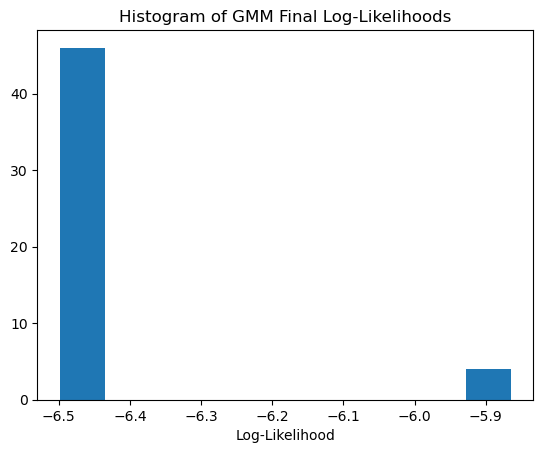
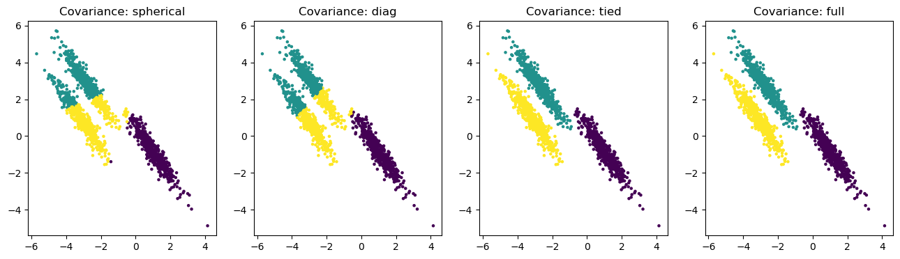
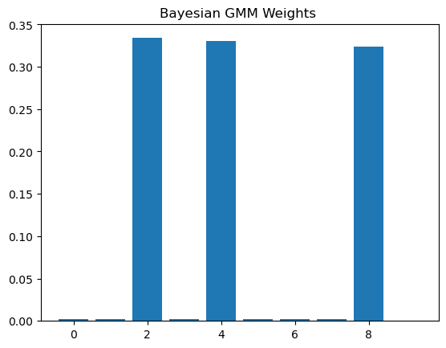

# Machine Learning – Assignment 4

## Overview
This assignment explores Expectation-Maximization (EM) and Gaussian Mixture Models (GMM). The experiments compare K-Means and GMM on anisotropic data, investigate the effect of random initialization, analyze covariance constraints and singularities, and demonstrate generative modeling and Bayesian GMM.

## Requirements
- Python 3
- NumPy
- Matplotlib
- Scikit-learn

Install the required libraries:

```bash
pip install numpy matplotlib scikit-learn
```

## Question 6 – EM & GMM

### Part 1: Geometry of Clustering
A synthetic dataset with three clusters was generated using `make_blobs` and transformed using a linear transformation to create anisotropic (elongated) clusters.

K-Means and a GMM with full covariance matrices were fitted to the transformed data.

K-Means minimizes the within-cluster sum of squared Euclidean distances. This implicitly favors spherical clusters and does not model correlations between features. Therefore, it struggles to capture elongated cluster shapes.

In contrast, GMM uses covariance matrices to model the orientation and spread of each component. With full covariance matrices, it can represent elliptical clusters and better adapt to the transformed data.

<p align="center">
  
</p>

### Part 2: Optimization Landscape and Initialization
A difficult dataset containing four clusters was generated using `make_blobs`. GMM was fitted 50 times with random initialization, using a different `random_state` for each run.

The histogram of final log-likelihood values shows multiple peaks because the GMM log-likelihood objective is non-convex. Consequently, the EM algorithm can converge to different local optima depending on its initialization.

A practical solution is to use multiple initializations (`n_init > 1`) and select the model with the highest log-likelihood. Better initialization strategies, such as K-Means-based initialization, can also improve convergence.

<p align="center">
  
</p>

### Part 3: Singularity – The Infinite Likelihood Problem
A dataset containing the first 100 samples and an additional outlier was used to demonstrate the singularity problem. A GMM was initialized with zero covariance regularization (`reg_covar=0`).

When a Gaussian component collapses onto a single data point, its mean approaches that point while its covariance approaches zero. The Gaussian density at the mean is proportional to:

$$
\frac{1}{\sqrt{(2\pi)^d|\Sigma|}}
$$

As the determinant of the covariance matrix approaches zero, the density can grow without bound. This causes the likelihood to become unbounded and can make model fitting fail.

The `reg_covar` parameter prevents this problem by adding a small positive value to the diagonal of each covariance matrix, keeping the covariance matrices numerically well-defined.

### Part 4: Covariance Constraints
Four GMM models were fitted to the anisotropic dataset using different covariance types:

- **Spherical:** Each component has a single variance shared across all dimensions.
- **Diagonal:** Each component has its own diagonal covariance matrix.
- **Tied:** All components share one full covariance matrix.
- **Full:** Each component has its own full covariance matrix.

The full covariance model is the most flexible because it can independently model the orientation, scale, and correlations of each cluster. However, it requires more parameters and can overfit, especially with limited data. Simpler covariance structures introduce stronger assumptions but can provide more stable and computationally efficient models.

<p align="center">
  
</p>

### Part 5: Generative Modeling
A GMM with 30 components and full covariance matrices was trained on the Scikit-learn digits dataset. Ten new samples were generated using the model's `sample()` method.

A discriminative model, such as Logistic Regression, learns the conditional probability \(P(y|x)\) to predict labels. A generative model learns the data distribution, allowing it to generate new samples.

K-Means does not explicitly model the probability distribution within each cluster. Therefore, it cannot generate realistic variations of the data in the same way as GMM, which can sample from its learned Gaussian components.

<p align="center">
  
</p>

### Part 6: Bayesian GMM
A Bayesian Gaussian Mixture Model was fitted to a synthetic dataset containing three clusters, with 10 possible components and a Dirichlet concentration prior of \(10^{-3}\).

A Dirichlet prior with \(\alpha < 1\) favors sparse mixing-weight vectors, where a small number of components receive most of the probability mass and the remaining components receive weights close to zero.

As a result, the Bayesian GMM can effectively reduce the contribution of unnecessary components and automatically favor a smaller number of active components.

<p align="center">
  
</p>

## Repository Structure

```text
Assignment4/
├── README.md
├── Assignment4.ipynb
└── figs/
    ├── kmeans_gmm_comparison.png
    ├── gmm_log_likelihood_histogram.png
    ├── covariance_comparison.png
    ├── generated_digits.png
    └── bayesian_gmm_weights.png
```

## How to Run

1. Install the required libraries.
2. Open `Assignment4.ipynb` in Jupyter Notebook.
3. Run all cells to reproduce the experiments and plots.

```bash
pip install numpy matplotlib scikit-learn
jupyter notebook Assignment4.ipynb
```

## Conclusion

This assignment demonstrates the advantages of GMM over K-Means for modeling clusters with complex shapes. It also highlights the importance of initialization in EM, the singularity problem, and the tradeoff between model flexibility and complexity. Finally, generative and Bayesian GMM models demonstrate how probabilistic modeling can be used to generate new data and reduce unnecessary mixture components.